<!-- Ezt a fájlt a readme/build.mjs generálja a readme/template.md alapján. Ne szerkeszd kézzel: írd át a sablont, és futtasd az npm run readme parancsot. -->

<p align="center">
  <picture><source media="(prefers-color-scheme: dark)" srcset="https://raw.githubusercontent.com/futozs/tarca/main/readme/assets/hero-dark.svg"></picture>
</p>

<p align="center">
  <b>Billingo, TypeScriptben, egyszerűbben.</b><br>
  TypeScript kliens a Billingo API v3-hoz, 0 függőséggel. Node, Bun, Deno és Cloudflare Workers alatt is fut, a típusai a Billingo hivatalos OpenAPI specifikációjából készülnek.<br>
  <sub><a href="https://github.com/futozs/tarca/blob/main/README.en.md">English overview</a></sub>
</p>

<p align="center">
  <a href="https://www.npmjs.com/package/tarca"></a>
  <a href="https://www.npmjs.com/package/tarca"></a>
  <a href="https://github.com/futozs/tarca/blob/main/package.json"></a>
  <a href="https://github.com/futozs/tarca/blob/main/LICENSE"></a>
  <br>
  <a href="https://github.com/futozs/tarca/actions/workflows/ci.yml?query=branch%3Amain"></a>
  <a href="https://github.com/futozs/tarca/actions/workflows/full-check.yml?query=branch%3Amain"></a>
  <a href="https://github.com/futozs/tarca/actions/workflows/release.yml?query=branch%3Amain"></a>
  <a href="https://scorecard.dev/viewer/?uri=github.com/futozs/tarca"></a>
  <br>
  <a href="https://github.com/futozs/tarca/actions/workflows/badges.yml"></a>
  <a href="https://github.com/futozs/tarca/actions/workflows/badges.yml"></a>
  <a href="https://github.com/futozs/tarca/actions/workflows/badges.yml"></a>
  <a href="https://github.com/futozs/tarca/actions/workflows/badges.yml"></a>
</p>

```bash
npm i tarca
```

```ts
import { createTarca } from 'tarca'

const tarca = createTarca()

const ceg = await tarca.utils.checkTaxNumber('12345676-2-41')

if (ceg.result === 'validation_ok') {
  console.log(ceg.taxpayerName, ceg.addresses?.[0]?.city)
}
```

Ennyi. Az API kulcsot a `BILLINGO_API_KEY` környezeti változóból olvassa, a mezőneveket camelCase-re alakítja, 429-es válasz után a `Retry-After` szerint újrapróbálja a lekérdezést, a hibából pedig magyar üzenetű `BillingoError` lesz.

> **A tárca 0.x, fejlesztés alatt áll.** Ma a szervezet adatai, az adószám-ellenőrzés, az árfolyam és a bankszámlák működnek. A bizonylatok, a partnerek, a termékek és a többi terület a [Fejlesztés alatt](#fejlesztés-alatt) részben szerepel. A 0.x verziókban az API még változhat.

## Miért tárca?

<p align="center">
  <picture><source media="(prefers-color-scheme: dark)" srcset="https://raw.githubusercontent.com/futozs/tarca/main/readme/assets/matrix-dark.svg"></picture>
</p>

- **0 futásidejű függőség.** Natív `fetch`, se axios, se node-fetch. A legtöbbet letöltött `@codingsans/billingo-client` úgy tölti be az axiost és a form-datát, hogy nem deklarálja őket, ezért tiszta telepítés után importáláskor hibát dob.
- **Bárhol fut.** Node 22+, Bun, Deno és Cloudflare Workers alatt, ESM és CommonJS buildként. A CI a lefordított csomagot mind a négy környezetben lefuttatja.
- **Típusok a hivatalos specből.** A 3.0.14-es és a 3.0.15-ös OpenAPI specből generálva, camelCase mezőnevekkel. Benne vannak a 3.0.15 újdonságai (emlékeztetők, készletmennyiség, bizonylattömb létrehozása, partnerkeresés), és a partner lekérése, módosítása és törlése is, amit a 3.0.15 kihagyott.
- **Több fiók egy folyamatban.** Minden `createTarca()` saját kulccsal és beállításokkal dolgozik, nincs globális állapot.
- **Betartja a sebességkorlátot.** A lekérdezést 429-es válasz, szerverhiba vagy hálózati hiba után újrapróbálja, és annyit vár, amennyit a `Retry-After` fejléc kér. Írást (POST, PUT, DELETE) soha nem küld újra magától.
- **Egy hibatípus.** Minden hiba `BillingoError`, magyar üzenettel, kategóriával, mezőhibákkal, a Billingo nyomkövetési azonosítójával és javítási tippel.
- **Élőben is tesztelve.** Minden kéréstörzset szerződésteszt vet össze a specifikációval, hetente élő e2e fut a Billingo teszt profilján, a változásfigyelő pedig jelez, ha a Billingo módosítja a specifikációt.

<details>
<summary><b>Részletes összehasonlítás</b> · 6 csomag, 11 szempont</summary>

|  | **tarca** | @codingsans/ billingo-client | @clientapi/ billingo | billingo_api_v3 | billingo-v3 | node-billingo |
|---|:---:|:---:|:---:|:---:|:---:|:---:|
| Billingo API | v3 | v3 | v3 | v3 | v3 | v2 |
| Műveletek (a 3.0.14-es specben 50) | részleges, fejlesztés alatt | 50 | 50 | 50 | 18 | v2-es kéréscsomagoló |
| Futásidejű függőség | **0** | 2, nem deklarált (axios, form-data) | 1 (axios 0.27) | 2 (@babel/cli, superagent) | 1 (node-fetch 2) | 9 (köztük request) |
| ESM és CJS | ✓ | csak CJS | ✓ | ✗ (le nem fordított ESM) | csak CJS | csak CJS |
| TypeScript típusok | ✓ | ✓ | ✓ | ✗ | ✗ | ✗ |
| Edge (Cloudflare Workers) | ✓ | ✗ | ✗ | ✗ | ✗ | ✗ |
| A 3.0.15-ös spec típusai | ✓ | ✗ | ✗ | ✗ | ✗ | ✗ |
| 429, `Retry-After` | ✓ | ✗ | ✗ | ✗ | ✗ | ✗ |
| Tesztek | ✓ | ✗ | ✗ | ✗ (generált vázak) | ✗ | ✓ |
| Több fiók egy folyamatban | ✓ | ✗ | ✓ | – | – | – |
| Utolsó kiadás | fejlesztés alatt | 2022. július | 2023. október | 2024. január | 2024. február | 2017. július |

<sub>Az adatok a 2026. november 15-i állapotot mutatják, az npm registry és a publikált csomagok kódja alapján. Az Edge sort a függőségekből töltöttük ki (axios 0.27, form-data, node-fetch, superagent, request, <code>fs</code>), nem futtattuk. A „–” azt jelenti, hogy nem ellenőriztük. A Billingo saját <code>@billingo/billingo-mcp</code> csomagja MCP szerver AI asszisztenseknek, nem importálható könyvtár, ezért nem szerepel a táblázatban. Az n8n- és Activepieces-bővítmények ugyanezért maradtak ki.</sub>

</details>

A tárca független, nyílt forráskódú projekt: nem a Billingo fejleszti, és nem áll kapcsolatban vele.

## Tartalom

| Kezdés | API | Megbízhatóság |
| --- | --- | --- |
| [Beállítás](#beállítás) | [Szervezet és segédvégpontok](#szervezet-és-segédvégpontok) | [Hibakezelés](#hibakezelés) |
| [Típusok](#típusok) | [Árfolyam](#árfolyam) | [Haladó beállítások](#haladó-beállítások) |
| [Futtatókörnyezetek](#futtatókörnyezetek) | [Bankszámlák](#bankszámlák) | [Fejlesztés alatt](#fejlesztés-alatt) |

## Beállítás

Az API kulcsot a Billingo felületén, az [API kulcsok](https://app.billingo.hu/api-key) oldalon hozhatod létre. Az API-t csak megfelelő Billingo előfizetéssel lehet használni.

```bash
BILLINGO_API_KEY=a-te-api-kulcsod
```

```ts
import { createTarca } from 'tarca'

export const tarca = createTarca()
```

<details>
<summary><b>Több fiók és a kulcs ellenőrzése</b> · <code>apiKey</code>, <code>verifyCredentials()</code></summary>

```ts
const bolt = createTarca({ apiKey: kulcsok.bolt })
const etterem = createTarca({ apiKey: kulcsok.etterem })

if (!(await etterem.verifyCredentials())) {
  throw new Error('Az étterem Billingo kulcsa érvénytelen.')
}
```

- Minden `createTarca()` hívás saját kulccsal és beállításokkal dolgozik, így egy folyamatban több Billingo fiók is kezelhető.
- A `verifyCredentials()` `false` értéket ad, ha a Billingo elutasítja a kulcsot. Minden más hibát (hálózat, előfizetés) továbbdob.
- Ha sehol nincs kulcs, a `createTarca()` azonnal `configuration` kategóriájú `BillingoError`-t dob.

</details>

## Szervezet és segédvégpontok

A fiók adatai, az adószám-ellenőrzés, a Billingo szerverideje és a régi azonosítók átváltása.

<details>
<summary><b>Szervezet adatai</b> · <code>organization.get()</code></summary>

```ts
const szervezet = await tarca.organization.get()

szervezet.taxCode
szervezet.subscription?.expirationDate
szervezet.hasNavConnection
```

Az előfizetés lejárata és a NAV-kapcsolat állapota is itt van, így induláskor ellenőrizheted, hogy a fiók használható-e.

</details>

<details>
<summary><b>Adószám ellenőrzése</b> · <code>utils.checkTaxNumber()</code></summary>

```ts
const ceg = await tarca.utils.checkTaxNumber('12345676-2-41')

if (ceg.result === 'validation_ok') {
  ceg.taxpayerName
  ceg.addresses?.[0]?.postalCode
}
```

A `result` értéke `validation_ok`, ha a NAV szerint az adószám érvényes. A többi lehetséges értéket (például `invalid_tax_number` vagy `no_online_szamla_settings`) a `Billingo.CheckTaxNumberMessage` típus sorolja fel.

</details>

<details>
<summary><b>Szerveridő és régi azonosítók</b> · <code>utils.serverTime()</code>, <code>utils.convertLegacyId()</code></summary>

```ts
const { w3c } = await tarca.utils.serverTime()

const { id } = await tarca.utils.convertLegacyId(1234567)
```

A `convertLegacyId()` a régi, API v2-es azonosítóhoz megadja az API v3-as azonosítót.

</details>

## Árfolyam

A Billingo árfolyama két deviza között, ha kell, egy adott napra.

<details>
<summary><b>Árfolyam lekérése</b> · <code>currencies.rate()</code></summary>

```ts
const { rate, date } = await tarca.currencies.rate({ from: 'EUR', to: 'HUF' })

const evVegi = await tarca.currencies.rate({ from: 'EUR', to: 'HUF', date: '2025-12-31' })
```

A dátum `YYYY-MM-DD` formájú szöveg vagy `Date` lehet. A `Date` értéket a tárca a budapesti idő szerinti napra váltja.

</details>

## Bankszámlák

Listázás oldalanként vagy az összes oldalon végig, létrehozás, lekérés, módosítás és törlés.

<details>
<summary><b>Listázás és lapozás</b> · <code>bankAccounts.list()</code>, <code>bankAccounts.all()</code></summary>

```ts
const oldal = await tarca.bankAccounts.list({ page: 1, perPage: 25 })

oldal.data
oldal.lastPage

for await (const bankszamla of tarca.bankAccounts.all()) {
  console.log(bankszamla.name, bankszamla.accountNumber, bankszamla.currency)
}
```

Az `all()` oldalanként 100 elemmel lapozza végig a listát. A `perPage` legfeljebb 100 lehet.

</details>

<details>
<summary><b>Létrehozás, módosítás, törlés</b> · <code>create()</code>, <code>get()</code>, <code>update()</code>, <code>delete()</code></summary>

```ts
const uj = await tarca.bankAccounts.create({
  name: 'Forint számla',
  accountNumber: '11111111-22222222',
  currency: 'HUF',
  needQr: true,
})

const meglevo = await tarca.bankAccounts.get(1234)

await tarca.bankAccounts.update(1234, {
  name: 'Fő számla',
  accountNumber: meglevo.accountNumber,
  currency: meglevo.currency,
})

await tarca.bankAccounts.delete(1234)
```

- Az `uj.id` az új bankszámla azonosítója.
- Az `update()` a teljes bankszámlát várja, nem csak a változó mezőket: a `name`, az `accountNumber` és a `currency` kötelező.

</details>

## Hibakezelés

Minden hiba `BillingoError`, magyar üzenettel, és ahol lehet, javítási tippel.

<details>
<summary><b>Mezőhibák és részletek</b> · <code>isBillingoError()</code>, <code>error.fieldErrors</code></summary>

```ts
import { isBillingoError } from 'tarca'

try {
  await tarca.bankAccounts.create(bankszamla)
} catch (error) {
  if (!isBillingoError(error)) throw error

  for (const { field, message } of error.fieldErrors) console.error(field, message)
  console.error(error.category, error.hint, error.traceId)
  throw error
}
```

- `error.fieldErrors`: a Billingo mezőnkénti hibái, például 422-es válasznál.
- `error.hint`: magyar javítási tipp, ha van.
- `error.traceId`: a Billingo nyomkövetési azonosítója, hibabejelentéshez hasznos.
- `error.status`, `error.operation`, `error.retryAfterMs`, `error.rateLimit`: a válasz további részletei.

</details>

<details>
<summary><b>Hibakategóriák</b> · <code>error.category</code></summary>

| `error.category` | Jelentés |
|---|---|
| `auth` | A Billingo nem fogadta el az API kulcsot (401) |
| `subscription` | Az előfizetés nem engedi a műveletet, vagy lejárt (402) |
| `forbidden` | A Billingo megtagadta a műveletet (403) |
| `not_found` | Nincs ilyen erőforrás (404) |
| `validation` | Hibás kérés vagy adat (400, 422), részletek a `fieldErrors`-ban |
| `rate_limit` | Túl sok kérés (429), a várakozási idő a `retryAfterMs`-ben |
| `server` | A Billingo szerverhibát adott (5xx) |
| `not_ready` | A kért fájl még készül (202) |
| `network` / `timeout` | Hálózati hiba vagy időtúllépés |
| `configuration` | Hibás beállítás, például hiányzó API kulcs; a kérés el sem ment |
| `unexpected_response` | A Billingo válasza nem értelmezhető |

Az `error.retryable` megmondja, hogy átmeneti-e a hiba (`rate_limit`, `server`, `not_ready`, `network`, `timeout`).

</details>

<details>
<summary><b>Ha nincs ilyen erőforrás</b> · <code>nullIfNotFound()</code></summary>

```ts
import { nullIfNotFound } from 'tarca'

const bankszamla = await nullIfNotFound(tarca.bankAccounts.get(1234))

if (bankszamla === null) console.log('Nincs ilyen bankszámla.')
```

Csak a `not_found` hibát alakítja `null` értékké, minden más hibát továbbdob.

</details>

> **Írást a tárca soha nem küld újra magától.** Újrapróbálás csak a lekérdezéseknél (GET) történik: 429-es válasz, szerverhiba, időtúllépés vagy hálózati hiba után, a `Retry-After` fejlécet betartva, alapból legfeljebb háromszor. Ha a Billingo egy percnél hosszabb várakozást kér, a tárca nem vár, hanem `rate_limit` hibát ad.

## Haladó beállítások

Időkorlát, újrapróbálás, naplózás hookokkal, megszakítás `AbortSignal`-lal és saját `fetch`.

<details>
<summary><b>Időkorlát, újrapróbálás és hookok</b> · <code>timeoutMs</code>, <code>maxAttempts</code>, <code>hooks</code></summary>

```ts
const tarca = createTarca({
  timeoutMs: 15_000,
  maxAttempts: 4,
  hooks: {
    onResponse: ({ operation, status, durationMs }) => logger.info({ operation, status, durationMs }),
    onError: ({ operation, error, willRetry }) =>
      logger.warn({ operation, category: error.category, willRetry }),
  },
})

await tarca.organization.get({ signal: AbortSignal.timeout(5_000) })
```

- Az alapértelmezett időkorlát 30 másodperc.
- A `maxAttempts` csak a lekérdezésekre vonatkozik: alapból 3, legfeljebb 5.
- A hookok (`onRequest`, `onResponse`, `onError`, `onComplete`) soha nem kapják meg az API kulcsot. Ha egy hook hibát dob, a kérés ettől nem bukik el, a hibát az `onWarning` kapja meg.
- Minden metódus fogad `AbortSignal`-t.
- A `fetch` opcióval saját `fetch` adható meg, például tesztekhez, a `baseUrl` opcióval pedig más API-cím.

</details>

## Típusok

A Billingo minden sémája TypeScript típusként is elérhető, a hivatalos OpenAPI specifikációból (3.0.14 és 3.0.15) generálva.

<details>
<summary><b>Billingo típusok</b> · <code>import type { Billingo } from 'tarca'</code></summary>

```ts
import type { Billingo } from 'tarca'

function fizetendo(bizonylat: Billingo.Document): number {
  return bizonylat.grossTotal ?? 0
}
```

- A tárca a kérésekben snake_case-re, a válaszokban camelCase-re alakítja a mezőneveket, így a Billingo leírásában szereplő `gross_total` itt `grossTotal`.
- A `BILLINGO_OPERATIONS` mind az 56 művelet HTTP-metódusát és útvonalát felsorolja, és azt is, melyik specben szerepel.

</details>

## Futtatókörnyezetek

Node 22+, Bun, Deno és Cloudflare Workers, ESM és CommonJS buildként, natív `fetch`-csel. A CI minden változásnál lefuttatja a lefordított csomagot Node, Bun, Deno és Cloudflare workerd alatt.

<details>
<summary><b>Cloudflare Workers</b> · <code>apiKey</code> a környezetből</summary>

```ts
import { createTarca } from 'tarca'

export default {
  async fetch(_request: Request, env: { BILLINGO_API_KEY: string }) {
    const tarca = createTarca({ apiKey: env.BILLINGO_API_KEY })
    return Response.json(await tarca.utils.serverTime())
  },
}
```

Workers alatt nincs `process.env`, ezért a kulcsot az `apiKey` opcióval add át.

</details>

## Fejlesztés alatt

A cél a Billingo API v3 mind az 54 dokumentált és 2 dokumentálatlan, élőben működő művelete. Ezek a területek még hiányoznak:

- **Bizonylatok:** számla, díjbekérő, előlegszámla, piszkozat, nyugta, sztornó, módosító bizonylat, másolat, kiküldés e-mailben, PDF, POS nyomtatás, nyilvános link, befizetések és NAV-státusz. Dupla számla nélküli kiállítás `createOnce()`-szal, a `vendorId` alapján.
- **Partnerek, termékek és bizonylattömbök.**
- **Költségek, export és készlet.**
- **Hamis Billingo teszteléshez** (`tarca/testing`).
- **Parancssor és MCP szerver.**

Ha valamelyikre most lenne szükséged, [írd meg egy issue-ban](https://github.com/futozs/tarca/issues/new?template=feature.yml).

## Ki használja?

A tárca nem küld semmilyen használati adatot, ezért csak az derül ki, ki használja, aki maga jelzi. Ha éles vagy kísérleti projektben használod, [írd meg egy issue-ban](https://github.com/futozs/tarca/issues/new?template=used-by.yml), és felkerülsz ide.

| Projekt | Mire használja |
| --- | --- |
| _Légy te az első._ | |

---

<p align="center">
  <a href="https://www.npmjs.com/package/tarca">npm</a> · <a href="https://github.com/futozs/tarca/blob/main/CHANGELOG.md">Változásnapló</a> · <a href="https://github.com/futozs/tarca/issues">Hibajegyek</a> · <a href="https://developers.billingo.hu/post/api-v3">Billingo API v3 dokumentáció</a>
</p>

<sub>A tárca független, nyílt forráskódú projekt: nem a Billingo fejleszti, és nem áll kapcsolatban vele. A Billingo API v3 hivatalos leírása a <a href="https://developers.billingo.hu/post/api-v3">developers.billingo.hu</a> oldalon érhető el. MIT licenc.</sub>
