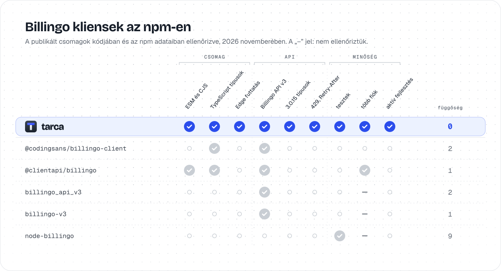

<!-- Ezt a fájlt a readme/build.mjs generálja a readme/template.md alapján. Ne szerkeszd kézzel: írd át a sablont, és futtasd az npm run readme parancsot. -->

<p align="center">
  <picture><source media="(prefers-color-scheme: dark)" srcset="https://raw.githubusercontent.com/futozs/tarca/main/readme/assets/hero-dark.svg"></picture>
</p>

<p align="center">
  <b>Billingo, TypeScriptben, egyszerűbben.</b><br>
  TypeScript kliens a Billingo API v3-hoz: mind az 57 művelet, 0 függőséggel. Node, Bun, Deno és Cloudflare Workers alatt is fut, a típusai a Billingo hivatalos OpenAPI specifikációjából készülnek.<br>
  <sub><a href="https://github.com/futozs/tarca/blob/main/README.en.md">English overview</a></sub>
</p>

<p align="center">
  <a href="https://www.npmjs.com/package/tarca"></a>
  <a href="https://www.npmjs.com/package/tarca"></a>
  <a href="https://github.com/futozs/tarca/blob/main/package.json"></a>
  <a href="https://github.com/futozs/tarca/blob/main/LICENSE"></a>
  <br>
  <a href="https://github.com/futozs/tarca/actions/workflows/ci.yml?query=branch%3Amain"></a>
  <a href="https://github.com/futozs/tarca/actions/workflows/full-check.yml?query=branch%3Amain"></a>
  <a href="https://github.com/futozs/tarca/actions/workflows/release.yml?query=branch%3Amain"></a>
  <a href="https://scorecard.dev/viewer/?uri=github.com/futozs/tarca"></a>
  <br>
  <a href="https://github.com/futozs/tarca/actions/workflows/badges.yml"></a>
  <a href="https://github.com/futozs/tarca/actions/workflows/badges.yml"></a>
  <a href="https://github.com/futozs/tarca/actions/workflows/badges.yml"></a>
  <a href="https://github.com/futozs/tarca/actions/workflows/badges.yml"></a>
</p>

```bash
npm i tarca
```

```ts
import { createTarca } from 'tarca'

const tarca = createTarca()

const szamla = await tarca.documents.create({
  partner: {
    name: 'Vevő Kft.',
    address: { postCode: '1111', city: 'Budapest', address: 'Fő utca 1.' },
    emails: ['vevo@ceg.hu'],
  },
  items: [{ name: 'Webfejlesztés', quantity: 10, unit: 'óra', netUnitPrice: 15_000, vat: 27 }],
})

console.log(szamla.invoiceNumber, szamla.grossTotal)
```

Ennyi. A partnert a tárca megkeresi, vagy ha még nincs, létrehozza. A számlatömböt, a teljesítés napját, a 8 napos fizetési határidőt és az áfakódot is ő tölti ki, a hibás adatot pedig még a kérés előtt, magyar üzenettel jelzi. A számlát a Billingo állítja ki és sorszámozza.

Webshopban vagy webhookból a `createOnce()` hívást használd, a rendelés azonosítójával: ha ugyanaz a rendelés kétszer érkezik, a második hívás a meglévő számlát adja vissza, újat nem állít ki ([Pontosan egyszer](#számlák)).

> **A tárca 0.x.** A Billingo API v3 mind az 57 művelete megvan, és mindegyiket élő e2e teszt futtatja a Billingo fejlesztői teszt profilján. A 0.x verziókban az API még változhat.

## Miért tárca?

<p align="center">
  <picture><source media="(prefers-color-scheme: dark)" srcset="https://raw.githubusercontent.com/futozs/tarca/main/readme/assets/matrix-dark.svg"></picture>
</p>

- **Mind az 57 művelet.** Számla, díjbekérő, előleg- és végszámla, nyugta, sztornó, módosító számla, befizetés, PDF, partnerek, termékek, készlet, számlatömbök, költségek és export. Ebből 3 művelet (a számlatömb lekérése, módosítása és törlése) egyik specben sem szerepel, ezeket élőben mértük ki.
- **Nincs dupla számla.** Írást a tárca soha nem küld újra magától. A `createOnce()` kiállítás előtt megkeresi a bizonylatot a `vendorId` alapján, bizonytalan hiba után pedig visszakeresi.
- **Fizetésből bizonylat.** Stripe, SimplePay, Barion, Revolut és PayPal webhookból pontosan egyszer nyugta vagy számla, visszatérítéskor sztornó vagy módosító számla.
- **Parancssor és MCP szerver.** Az `npx tarca doctor` 3 olvasó kéréssel ellenőrzi a kulcsot, a profilt, a NAV-kapcsolatot és a számlatömböket. Az MCP szerver az AI asszisztensnek csak előnézet és megerősítő kód után enged számlát kiállítani.
- **0 futásidejű függőség.** Natív `fetch`, se axios, se node-fetch. A legtöbbet letöltött `@codingsans/billingo-client` úgy tölti be az axiost és a form-datát, hogy nem deklarálja őket, ezért tiszta telepítés után importáláskor hibát dob.
- **Bárhol fut.** Node 22+, Bun, Deno és Cloudflare Workers alatt, ESM és CommonJS buildként. A CI a lefordított csomagot mind a négy környezetben lefuttatja.
- **Típusok a hivatalos specből, a valósághoz igazítva.** A 3.0.14-es és a 3.0.15-ös OpenAPI specből generálva, camelCase mezőnevekkel. Ahol a Billingo mást küld, mint amit a spec ír (`null` értékek, eltérő státuszkódok és tartalomtípusok, más mezőnév), ott a típus az élő mérést követi.
- **Betartja a sebességkorlátot.** A lekérdezést 429-es válasz, szerverhiba vagy hálózati hiba után újrapróbálja, és annyit vár, amennyit a `Retry-After` fejléc kér.
- **Egy hibatípus.** Minden hiba `BillingoError`, magyar üzenettel, kategóriával, mezőhibákkal, a Billingo nyomkövetési azonosítójával és javítási tippel.
- **Hamis Billingo a tesztekhez.** A `tarca/testing` memóriában futó Billingót ad, a valódi sorszámozással, kerekítéssel és hibaüzenetekkel, így a saját kódod tesztje sem hívja az éles API-t.

<details>
<summary><b>Részletes összehasonlítás</b> · 6 csomag, 13 szempont</summary>

|  | **tarca** | @codingsans/ billingo-client | @clientapi/ billingo | billingo_api_v3 | billingo-v3 | node-billingo |
|---|:---:|:---:|:---:|:---:|:---:|:---:|
| Billingo API | v3 | v3 | v3 | v3 | v3 | v2 |
| Műveletek (a 3.0.14-es specben 50) | **57**, mind | 50 | 50 | 50 | 18 | v2-es kéréscsomagoló |
| Futásidejű függőség | **0** | 2, nem deklarált (axios, form-data) | 1 (axios 0.27) | 2 (@babel/cli, superagent) | 1 (node-fetch 2) | 9 (köztük request) |
| ESM és CJS | ✓ | csak CJS | ✓ | ✗ (le nem fordított ESM) | csak CJS | csak CJS |
| TypeScript típusok | ✓ | ✓ | ✓ | ✗ | ✗ | ✗ |
| Edge (Cloudflare Workers) | ✓ | ✗ | ✗ | ✗ | ✗ | ✗ |
| A 3.0.15-ös spec típusai | ✓ | ✗ | ✗ | ✗ | ✗ | ✗ |
| 429, `Retry-After` | ✓ | ✗ | ✗ | ✗ | ✗ | ✗ |
| Tesztek | ✓ | ✗ | ✗ | ✗ (generált vázak) | ✗ | ✓ |
| Több fiók egy folyamatban | ✓ | ✗ | ✓ | – | – | – |
| Webhookból bizonylat (Stripe, SimplePay, Barion, Revolut, PayPal) | ✓ | ✗ | ✗ | ✗ | ✗ | ✗ |
| Parancssor és MCP szerver | ✓ | ✗ | ✗ | ✗ | ✗ | ✗ |
| Utolsó kiadás | még nincs kiadva | 2022. július | 2023. október | 2024. január | 2024. február | 2017. július |

<sub>Az adatok a 2026. november 15-i állapotot mutatják, az npm registry és a publikált csomagok kódja alapján. A tárca 57 művelete a 3.0.14-es és a 3.0.15-ös spec összes műveletét és a nem dokumentált, élőben működő 3 műveletet jelenti. Az Edge sort a függőségekből töltöttük ki (axios 0.27, form-data, node-fetch, superagent, request, <code>fs</code>), nem futtattuk. A „–” azt jelenti, hogy nem ellenőriztük. A Billingo saját <code>@billingo/billingo-mcp</code> csomagja MCP szerver AI asszisztenseknek, nem importálható könyvtár, ezért nem szerepel a táblázatban. Az n8n- és Activepieces-bővítmények ugyanezért maradtak ki.</sub>

</details>

A tárca független, nyílt forráskódú projekt: nem a Billingo fejleszti, és nem áll kapcsolatban vele.

## Tartalom

| Kezdés | Bizonylatok | Törzsadatok | Megbízhatóság és kiegészítők |
| --- | --- | --- | --- |
| [Beállítás](#beállítás) | [Számlák](#számlák) | [Partnerek](#partnerek) | [Hibakezelés](#hibakezelés) |
| [Típusok](#típusok) | [Nyugták](#nyugták) | [Termékek és készlet](#termékek-és-készlet) | [Tesztelés](#tesztelés) |
| [Futtatókörnyezetek](#futtatókörnyezetek) | [Befizetések](#befizetések) | [Számlatömbök és bankszámlák](#számlatömbök-és-bankszámlák) | [Bizonylatnapló](#bizonylatnapló) |
| [Serverless és edge](#serverless-és-edge) | [PDF, e-mail, NAV](#pdf-e-mail-nav) | [Költségek és export](#költségek-és-export) | [PDF mentése tárhelyre](#pdf-mentése-tárhelyre) |
| [Node.js és Express](#nodejs-és-express) | [Fizetésből bizonylat](#fizetésből-bizonylat) | [Szervezet és segédvégpontok](#szervezet-és-segédvégpontok) | [Megfigyelhetőség](#megfigyelhetőség) |
| [Haladó beállítások](#haladó-beállítások) | [Tömeges és ismétlődő számlázás](#tömeges-és-ismétlődő-számlázás) | | [Parancssor és MCP szerver](#parancssor-és-mcp-szerver) |
| [AI-val kódolsz?](#ai-val-kódolsz) | | | |

## Beállítás

Az API kulcsot a Billingo felületén, az [API kulcsok](https://app.billingo.hu/api-key) oldalon hozhatod létre. Az API-t csak megfelelő Billingo előfizetéssel lehet használni. Fejlesztéshez a Billingo ingyenes fejlesztői teszt profilját használd: NAV kapcsolata nincs, a bizonylatain „TESZT” felirat van.

```bash
BILLINGO_API_KEY=a-te-api-kulcsod
```

```ts
import { createTarca } from 'tarca'

export const tarca = createTarca()
```

<details>
<summary><b>Alapbeállítások</b> · <code>defaults</code></summary>

Ami minden bizonylaton ugyanaz, azt elég egyszer megadni:

```ts
export const tarca = createTarca({
  defaults: {
    blockId: 123456,
    bankAccountId: 7890,
    paymentMethod: 'wire_transfer',
    language: 'hu',
    currency: 'HUF',
    dueInDays: 8,
    electronic: true,
    sendEmail: true,
  },
})
```

- A `blockId` nélkül a tárca az első `invoice` típusú számlatömböt használja (egyszer kérdezi le, utána megjegyzi), nyugtához az első `receipt` típusút, vagy a `receiptBlockId`-t.
- Nyugtánál is a `defaults.paymentMethod` érvényes, ha a nyugta nem ad meg fizetési módot. Ha egyik sincs megadva, a nyugta `cash`, a számla `wire_transfer`. Ha a számláid átutalásosak, a nyugtáidon pedig készpénz vagy kártya szerepel, add meg minden nyugtán a `paymentMethod`-ot.
- A `dueInDays` a mai budapesti naptól számít. A `sendEmail` a bizonylat `settings.shouldSendEmail` beállítása.
- Hibás érték esetén a `createTarca()` azonnal `configuration` hibát dob, nem az első számlánál.

</details>

<details>
<summary><b>Több fiók és a kulcs ellenőrzése</b> · <code>apiKey</code>, <code>verifyCredentials()</code></summary>

```ts
const bolt = createTarca({ apiKey: kulcsok.bolt })
const etterem = createTarca({ apiKey: kulcsok.etterem })

if (!(await etterem.verifyCredentials())) {
  throw new Error('Az étterem Billingo kulcsa érvénytelen.')
}
```

- Minden `createTarca()` hívás saját kulccsal és beállításokkal dolgozik, így egy folyamatban több Billingo fiók is kezelhető.
- A `verifyCredentials()` `false` értéket ad, ha a Billingo elutasítja a kulcsot. Minden más hibát (hálózat, előfizetés) továbbdob.
- Ha sehol nincs kulcs, a `createTarca()` azonnal `configuration` kategóriájú `BillingoError`-t dob.

</details>

## Számlák

Számla, díjbekérő, előleg- és végszámla, piszkozat, sztornó és módosító számla. A Billingo a kiállított számlát éles profilon azonnal beküldi a NAV-nak, törölni nem lehet, csak sztornózni.

<details>
<summary><b>Számla</b> · <code>documents.create()</code></summary>

```ts
const szamla = await tarca.documents.create({
  partner: 1234,
  items: [
    { name: 'Webfejlesztés', quantity: 10, unit: 'óra', netUnitPrice: 15_000, vat: 27 },
    { name: 'Tankönyv', quantity: 2, grossUnitPrice: 4_200, vat: 5 },
  ],
  fulfillmentDate: '2026-11-15',
  dueInDays: 15,
  comment: 'Köszönjük a megrendelést!',
  orderNumber: 'RENDELES-1001',
})

szamla.id
szamla.invoiceNumber
szamla.grossTotal
```

- A `partner` egy meglévő partner azonosítója, vagy egy partner adatai. Az adatokat a `partners.findOrCreate()` keresi meg, és csak akkor hoz létre új partnert, ha nincs pontosan ilyen (lásd [Partnerek](#partnerek)).
- A `type` alapból `'invoice'`; lehet `'proforma'`, `'advance'` és `'draft'` is.
- A dátumok `YYYY-MM-DD` szövegek vagy `Date` értékek, a tárca a budapesti napra váltja őket. A teljesítés alapból a mai nap, a határidőt a `dueDate` vagy a `dueInDays` adja meg (a kettő közül csak az egyik).
- Az összegeket a Billingo számolja, áfakulcsonként kerekítve. A hibás bemenetet a tárca a kérés elküldése előtt elutasítja, mezőnkénti magyar hibaüzenettel.

</details>

<details>
<summary><b>Nettó vagy bruttó ár, áfakulcsok, termékek</b> · <code>netUnitPrice</code>, <code>grossUnitPrice</code>, <code>vat</code>, <code>productId</code></summary>

```ts
const items = [
  { name: 'Tanácsadás', quantity: 3, unit: 'óra', netUnitPrice: 20_000, vat: 27 },
  { name: 'Belépőjegy', quantity: 2, grossUnitPrice: 5_000, vat: 'TAM' },
  { productId: 5678, quantity: 1 },
] as const
```

- Tételenként pontosan az egyik árat add meg: `netUnitPrice` (nettó egységár) vagy `grossUnitPrice` (bruttó egységár). Az egység alapból `db`.
- A `vat` lehet szám (`27` → `'27%'`, `5.5` → `'5,5%'`) vagy a Billingo saját kódja (`'AAM'`, `'TAM'`, `'EU'`, `'EUK'`, `'F.AFA'` és a többi a `Billingo.Vat` típusban).
- A `{ productId, quantity }` tétel a Billingóban tárolt termék nevét, árát és áfáját használja.
- Bruttó egységárnál a Billingo a nettó egységárat hat tizedesre számolja (1270 Ft bruttó 27%-kal: 1000.000001), a sor nettója pedig a sor bruttójából jön ki.

</details>

<details>
<summary><b>Pontosan egyszer</b> · <code>documents.createOnce()</code>, <code>receipts.createOnce()</code></summary>

```ts
const { document, created } = await tarca.documents.createOnce({
  vendorId: `RENDELES-${rendeles.id}`,
  partner: rendeles.vevoPartnerId,
  items: rendeles.tetelek,
})
```

- Kiállítás előtt megkeresi a bizonylatot a `vendorId` alapján. Ha már van, a meglévőt adja vissza `created: false` értékkel.
- Hálózati hiba, időtúllépés, szerverhiba vagy értelmezhetetlen válasz után kétszer visszakeresi. Ha a számla mégis elkészült, megkapod (`created: true`), ha nem, az eredeti hiba megy tovább.
- Ha egy másik folyamat közben kiállította ugyanazt (a Billingo 400 `Duplicate vendor id.` hibát ad), a meglévőt adja vissza. Ha ilyenkor a visszakeresés is hibát ad, a keresés hibája megy tovább (például `server`) azzal a tippel, hogy a bizonylat már létezik: ne állítsd ki újra, később hívd meg ugyanígy a `createOnce`-t.
- Ha a kiállítás előtti lépés (a számlatömb vagy a partner keresése) hibázik, a tárca a hibát változatlanul továbbadja: számla nem ment ki, a hívás megismételhető.
- A `vendorId` nem lehet `.` vagy `..`: a `fetch` ezt útvonal-lépésnek venné, és a kérés más végpontra menne. A tárca ilyenkor kérés nélkül `validation` hibát ad.
- Egy folyamaton belül az azonos `vendorId`-ra egyszerre érkező hívások egyetlen kérést küldenek. Több szerver vagy serverless példány között a `createOnceLock` közös tároló zárja véd; a tároló felülete ugyanaz, mint a kasszáé:

```ts
const tarca = createTarca({ createOnceLock: store })
```

- A `vendorId` sztornó után is foglalt marad: a sztornózott rendelés újbóli számlázásához új `vendorId` kell.

</details>

<details>
<summary><b>Díjbekérő, majd számla</b> · <code>type: 'proforma'</code>, <code>documents.createFromProforma()</code></summary>

```ts
const dijbekero = await tarca.documents.create({ type: 'proforma', partner: 1234, items })

const szamla = await tarca.documents.createFromProforma(dijbekero.id ?? 0, { dueInDays: 0 })

await tarca.documents.archive(dijbekero.id ?? 0)
```

- A díjbekérőből készült számla fizetettként jön létre (`paymentStatus: 'paid'`), a `relatedDocuments` mezőjében ott a díjbekérő.
- A teljesítés alapból a mai nap, a határidő a mai nap és a `dueInDays`.
- Az `archive()` a díjbekérőt archiválja, utána nem jelenik meg a listában.

</details>

<details>
<summary><b>Előleg- és végszámla</b> · <code>type: 'advance'</code>, <code>advanceInvoiceIds</code></summary>

```ts
const eloleg = await tarca.documents.create({
  type: 'advance',
  partner: 1234,
  items: [{ name: 'Előleg', quantity: 1, netUnitPrice: 50_000, vat: 27 }],
})

const vegszamla = await tarca.documents.create({
  partner: 1234,
  items: [{ name: 'Konyhabútor', quantity: 1, netUnitPrice: 200_000, vat: 27 }],
  advanceInvoiceIds: [eloleg.id ?? 0],
})
```

A végszámla automatikusan kap egy negatív előlegsort, így a végösszege 190 500 Ft (150 000 Ft nettó). Sztornózni fordított sorrendben lehet: előbb a végszámlát, aztán az előleget.

</details>

<details>
<summary><b>Devizás számla, angol nyelven</b> · <code>currency</code>, <code>conversionRate</code>, <code>language</code></summary>

```ts
const { rate } = await tarca.currencies.rate({ from: 'EUR', to: 'HUF' })

const szamla = await tarca.documents.create({
  partner: 1234,
  currency: 'EUR',
  conversionRate: rate,
  language: 'en',
  items: [{ name: 'Consulting', quantity: 3, unit: 'hour', netUnitPrice: 120, vat: 27 }],
})
```

Nem forintos számlához kötelező az árfolyam, nélküle a tárca kérés nélkül hibát ad. A forintos összegeket (`summary.netAmountLocal` és a többi) a Billingo számolja.

</details>

<details>
<summary><b>Piszkozat és másolat</b> · <code>type: 'draft'</code>, <code>finalizeDraft()</code>, <code>copy()</code>, <code>deleteDraft()</code></summary>

```ts
const piszkozat = await tarca.documents.create({ type: 'draft', partner: 1234, items })

const szamla = await tarca.documents.finalizeDraft(piszkozat.id ?? 0, { partner: 1234, items })

const masolat = await tarca.documents.copy(szamla.id ?? 0)
await tarca.documents.deleteDraft(masolat.id ?? 0)
```

- A piszkozatnak nincs sorszáma. A `finalizeDraft()` a teljes számlát várja, és ugyanazzal az azonosítóval számlát csinál belőle.
- A `copy()` mindig piszkozatot ad, ugyanazokkal a tételekkel.
- Törölni csak piszkozatot lehet. Kiállított számlát csak sztornózni.

</details>

<details>
<summary><b>Sztornó és módosító számla</b> · <code>documents.cancel()</code>, <code>documents.createModification()</code></summary>

```ts
const sztorno = await tarca.documents.cancel(4321, {
  reason: 'A vevő elállt a vásárlástól.',
  recipients: ['vevo@ceg.hu'],
})

const modosito = await tarca.documents.createModification(4322, {
  items: [{ name: 'Kedvezmény utólag', quantity: 1, netUnitPrice: -5_000, vat: 27 }],
  comment: 'Utólagos árengedmény',
})
```

- A `cancel()` a sztornó bizonylatot adja vissza (`type: 'cancellation'`, nyugtánál `'receipt_cancellation'`, negatív végösszeggel). Az eredeti számla `cancelled: true` lesz, a fizetési állapota `none`.
- A módosító számla tételei a különbözetek. Módosító számla után sem az eredetit, sem a módosítót nem lehet sztornózni: a Billingo 400-as hibát ad, a tárca magyar tippel adja tovább. Ilyenkor újabb módosító számlával lehet helyesbíteni.

</details>

<details>
<summary><b>Lekérdezés és lista</b> · <code>get()</code>, <code>findByVendorId()</code>, <code>list()</code>, <code>all()</code></summary>

```ts
const szamla = await tarca.documents.get(4321)
const rendeleshez = await tarca.documents.findByVendorId('RENDELES-1001')

const kifizetetlen = await tarca.documents.list({
  type: 'invoice',
  paymentStatus: 'outstanding',
  startDate: '2026-11-01',
  endDate: '2026-11-30',
})

for await (const bizonylat of tarca.documents.all({ partnerId: 1234 })) {
  console.log(bizonylat.invoiceNumber, bizonylat.grossTotal)
}
```

- A `findByVendorId()` `null` értéket ad, ha nincs ilyen bizonylat; a `getByVendorId()` ilyenkor `not_found` hibát dob.
- A törölt vagy ismeretlen azonosítóra a `get()` 403-as, `forbidden` hibát kap, nem 404-et.
- A lista minden Billingo szűrőt ismer (számlatömb, partner, fizetési mód és állapot, dátumok, sorszám, `query`, `lastModifiedDate`). A friss bizonylat akár fél perc késéssel jelenik meg benne.

</details>

## Nyugták

Nyugta partnerrel vagy partner nélkül, bruttó árakkal, a nyugtatömbbe.

<details>
<summary><b>Nyugta</b> · <code>receipts.create()</code></summary>

```ts
const nyugta = await tarca.receipts.create({
  items: [
    { name: 'Kávé', quantity: 2, grossUnitPrice: 600, vat: 27 },
    { name: 'Croissant', grossUnitPrice: 750, vat: 5 },
  ],
  paymentMethod: 'bankcard',
})
```

- A nyugta a `defaults.receiptBlockId` vagy az első `receipt` típusú tömbbe kerül, fizetettként, a határidő a kiállítás napja.
- A nyugta árai bruttók. Az áfa `5`, `18`, `27` vagy `'none'`, `'AAM'`, `'TAM'` lehet. A mennyiség alapból 1, az egység `db`.
- Partner nélkül a Billingo a közös „Magánszemély” partnert teszi rá.
- Pontosan egyszeri kiállításhoz: `receipts.createOnce({ vendorId, ... })`. Nyugta piszkozatból: `receipts.create({ type: 'draft', ... })`, majd `receipts.finalizeDraft(id, ...)`. A nyugta sztornója a `documents.cancel()`.

</details>

## Befizetések

<details>
<summary><b>Befizetés rögzítése</b> · <code>documents.payments.add()</code>, <code>replace()</code>, <code>list()</code>, <code>clear()</code></summary>

```ts
await tarca.documents.payments.add(4321, {
  date: new Date(),
  price: 63_500,
  paymentMethod: 'wire_transfer',
})

const befizetesek = await tarca.documents.payments.list(4321)

await tarca.documents.payments.clear(4321)
```

- A számla `paymentStatus` mezője a befizetések szerint `partially_paid`, `paid` vagy `outstanding` lesz.
- A Billingo a befizetéseket csak egyben tudja cserélni. A `replace()` a teljes listát írja felül, az `add()` előbb lekéri a meglévőket, és a végükre fűzi az újat. Egy számla befizetéseit egyszerre csak egy folyamat írja, különben elveszhet egy befizetés.

</details>

## PDF, e-mail, NAV

<details>
<summary><b>PDF, POS nyomtatás és nyilvános link</b> · <code>documents.pdf()</code>, <code>posPdf()</code>, <code>publicUrl()</code></summary>

```ts
import { writeFile } from 'node:fs/promises'

const pdf = await tarca.documents.pdf(4321)
await writeFile(pdf.filename ?? 'szamla.pdf', pdf.bytes)

const blokk = await tarca.documents.posPdf(4321, { size: 80 })

const link = await tarca.documents.publicUrl(4321)
```

- Kiállítás után a PDF néhány másodpercig készülhet (a Billingo ilyenkor 202-t ad). A `pdf()` kivárja, alapból legfeljebb 30 másodpercig (`maxWaitMs`). Ebbe a hívás kezdetétől minden várakozás beleszámít, a `maxWaitMs: 0` egyetlen kérés.
- A `posPdf()` 58 vagy 80 mm széles blokknyomtatóra készít PDF-et.
- A tárca a PDF-et a tartalma alapján ellenőrzi, nem a tartalomtípus alapján, mert a Billingo a POS PDF-et `application/octet-stream` típussal küldi.

</details>

<details>
<summary><b>Kiküldés e-mailben és emlékeztetők</b> · <code>documents.send()</code>, <code>reminders()</code></summary>

```ts
await tarca.documents.send(4321, { emails: ['vevo@ceg.hu', 'konyveles@ceg.hu'] })

const { sentReminders, upcomingReminders } = await tarca.documents.reminders(4321)
```

A `send()` pontosan a megadott címekre küldi a bizonylatot. A címeket a tárca előre ellenőrzi.

</details>

<details>
<summary><b>NAV-állapot</b> · <code>documents.navStatus()</code></summary>

```ts
const nav = await tarca.documents.navStatus(4321)

if (nav === null) console.log('A Billingónak még nincs NAV rekordja erről a számláról.')
else console.log(nav.status, nav.messages?.[0]?.humanReadableMessage)
```

Közvetlenül a kiállítás után néhány másodpercig nincs NAV rekord: a Billingo ilyenkor 404-et ad, a tárca `null` értéket. A fejlesztői teszt profilon a státusz `no_online_szamla_settings`.

</details>

## Partnerek

Keresés, létrehozás, módosítás és törlés, valamint a számlázáshoz a `findOrCreate()`.

<details>
<summary><b>Partner keresése vagy létrehozása</b> · <code>partners.findOrCreate()</code></summary>

```ts
const { partner, created } = await tarca.partners.findOrCreate({
  name: 'Vevő Kft.',
  address: { postCode: '1111', city: 'Budapest', address: 'Fő utca 1.' },
  emails: ['vevo@ceg.hu'],
  taxcode: '12345678-2-41',
})
```

- Név szerint keres, és csak akkor használja a meglévő partnert, ha minden megadott mezője pontosan egyezik. Különben újat hoz létre, így a számlára soha nem kerül régi cím vagy adószám.
- A Billingo keresője késik: a pár másodperce létrehozott vagy átnevezett partnert akár egy percig sem találja. Ilyenkor legfeljebb egy fölösleges partner jön létre, rossz számla nem.
- Az ország alapból `HU`. Az adószám mezőjének neve a Billingo írásmódja szerint `taxcode`.

</details>

<details>
<summary><b>Lista, létrehozás, módosítás, törlés</b> · <code>list()</code>, <code>all()</code>, <code>get()</code>, <code>create()</code>, <code>update()</code>, <code>delete()</code></summary>

```ts
const talalatok = await tarca.partners.list({ query: 'vevő' })

const adatok = {
  name: 'Vevő Kft.',
  address: { postCode: '1111', city: 'Budapest', address: 'Fő utca 1.' },
  taxType: 'HAS_TAX_NUMBER',
  taxcode: '12345678-2-41',
} as const

const partner = await tarca.partners.create(adatok)
await tarca.partners.update(partner.id ?? 0, { ...adatok, phone: '+36 1 234 5678' })
await tarca.partners.delete(partner.id ?? 0)
```

- A `query` csak a névben keres, a szavak elejére illesztve, adószámra és e-mail címre nem.
- Az `update()` a teljes partnert várja, azonosító nélkül: ami kimarad, az törlődik (a telefonszám, az e-mail címek és a többi).
- A bizonylattal rendelkező partner is törölhető, a bizonylatok megtartják az adatait.
- A `guess()` nem keresés: pontos névegyezésen kívül mindig új partnert hoz létre. Kereséshez a `list()` és a `findOrCreate()` való.

</details>

## Termékek és készlet

<details>
<summary><b>Termékek</b> · <code>products.list()</code>, <code>create()</code>, <code>update()</code>, <code>delete()</code></summary>

```ts
const adatok = { name: 'Tanácsadás', currency: 'HUF', vat: '27%', unit: 'óra' } as const

const termek = await tarca.products.create({ ...adatok, netUnitPrice: 20_000 })
await tarca.products.update(termek.id ?? 0, { ...adatok, grossUnitPrice: 30_000 })

for await (const talalat of tarca.products.all({ query: 'tanács' })) console.log(talalat.name)
```

Pontosan egy árat adj meg, nettót vagy bruttót: a másikat a Billingo számolja ki az áfakulcsból. Az `update()` teljes csere, a kihagyott megjegyzés kiürül. A lekért terméken mindkét ár ott van, ezért visszaíráskor az egyiket el kell hagyni.

</details>

<details>
<summary><b>Készlet</b> · <code>inventory.quantity()</code></summary>

```ts
const { availableQuantity } = await tarca.inventory.quantity(5678)
```

Csak bekapcsolt készletkezeléssel működik. Nélküle (a fejlesztői teszt profilon is) a Billingo 400-as hibát ad, a tárca `validation` hibát, magyar tippel.

</details>

## Számlatömbök és bankszámlák

<details>
<summary><b>Számlatömbök</b> · <code>documentBlocks.list()</code>, <code>create()</code>, <code>get()</code>, <code>update()</code>, <code>delete()</code></summary>

```ts
const { data: szamlatombok } = await tarca.documentBlocks.list({ type: 'invoice' })

const webshop = await tarca.documentBlocks.create({ name: 'Webshop', prefix: 'WEB', type: 'invoice' })

const tomb = await tarca.documentBlocks.get(webshop.id ?? 0)
await tarca.documentBlocks.update(webshop.id ?? 0, { ...tomb, customField1: 'Webshop rendelés' })
```

- A tömb neve csak betűt, számot és szóközt tartalmazhat (`Webshop 2`, de nem `Web-shop`), ezt a tárca előre ellenőrzi.
- A lekérés, a módosítás és a törlés egyik Billingo specben sem szerepel, de élőben működik, és az e2e teszt futtatja. A módosítás teljes csere; a lekért tömb visszaírható, a tárca kihagyja belőle a `null` mezőket, mert azokra a Billingo 422-t ad.
- Törölni csak bizonylat nélküli tömböt próbáltunk ki.

</details>

<details>
<summary><b>Bankszámlák</b> · <code>bankAccounts.list()</code>, <code>all()</code>, <code>create()</code>, <code>get()</code>, <code>update()</code>, <code>delete()</code></summary>

```ts
const adatok = { name: 'Forint számla', accountNumber: '11111111-22222222', currency: 'HUF' } as const

const uj = await tarca.bankAccounts.create(adatok)
await tarca.bankAccounts.update(uj.id ?? 0, { ...adatok, name: 'Fő számla' })

for await (const bankszamla of tarca.bankAccounts.all()) {
  console.log(bankszamla.name, bankszamla.accountNumber, bankszamla.currency)
}

await tarca.bankAccounts.delete(uj.id ?? 0)
```

Az `update()` a teljes bankszámlát várja, azonosító nélkül: a kihagyott IBAN és SWIFT kiürül.

</details>

## Költségek és export

<details>
<summary><b>Költségek</b> · <code>spendings.list()</code>, <code>create()</code>, <code>get()</code>, <code>update()</code>, <code>delete()</code></summary>

```ts
const koltseg = await tarca.spendings.create({
  category: 'service',
  currency: 'HUF',
  conversionRate: 1,
  totalGross: 12_700,
  totalGrossHuf: 12_700,
  totalVatAmount: 2_700,
  totalVatAmountHuf: 2_700,
  invoiceNumber: 'SZLA-2026-42',
  invoiceDate: '2026-11-10',
  fulfillmentDate: '2026-11-10',
  dueDate: '2026-11-18',
  paymentMethod: 'wire_transfer',
})

const fizetetlen = await tarca.spendings.list({ paymentStatus: 'unpaid' })
```

A spec szerint opcionális `conversionRate`, `invoiceNumber`, `invoiceDate` és `dueDate` mezőt a Billingo megköveteli (forintnál az árfolyam `1`), ezért a típus is kötelezőnek írja. A forintos összegeket úgy tárolja, ahogy küldöd.

</details>

<details>
<summary><b>Export</b> · <code>exports.run()</code>, <code>create()</code>, <code>poll()</code>, <code>download()</code></summary>

```ts
import { writeFile } from 'node:fs/promises'

const exportfajl = await tarca.exports.run({
  queryType: 'invoice_date',
  startDate: '2026-11-01',
  endDate: '2026-11-30',
  exportType: 'simple_csv',
})

await writeFile(exportfajl.filename ?? 'export.csv', exportfajl.bytes)
```

- A `run()` elindítja az exportot, megvárja, amíg elkészül (alapból legfeljebb 60 másodpercig), és letölti. Ha addig nem készül el, `not_ready` hibát ad az export azonosítójával, és később a `poll()` és a `download()` folytatja.
- A `simple_csv` UTF-8 BOM-mal kezdődik, a mezőket pontosvessző választja el.

</details>

## Szervezet és segédvégpontok

<details>
<summary><b>Szervezet adatai</b> · <code>organization.get()</code></summary>

```ts
const szervezet = await tarca.organization.get()

szervezet.taxCode
szervezet.subscription?.expirationDate
szervezet.hasNavConnection
```

Az előfizetés lejárata és a NAV kapcsolat állapota is itt van, így induláskor ellenőrizheted, hogy a fiók használható-e.

</details>

<details>
<summary><b>Adószám ellenőrzése</b> · <code>utils.checkTaxNumber()</code></summary>

```ts
const ceg = await tarca.utils.checkTaxNumber('12345676-2-41')

if (ceg.result === 'validation_ok') {
  ceg.taxpayerName
  ceg.addresses?.[0]?.postalCode
}
```

- Élő NAV kapcsolat kell hozzá. A fejlesztői teszt profilon a Billingo 401-et ad, ebből `nav_unavailable` hiba lesz, nem `auth`: a kulcs ettől még jó.
- Az adószámot a teljes `NNNNNNNN-N-NN` alakban kell megadni, a rövid alakot a tárca kérés nélkül elutasítja.

</details>

<details>
<summary><b>Árfolyam, szerveridő, régi azonosítók</b> · <code>currencies.rate()</code>, <code>utils.serverTime()</code>, <code>utils.convertLegacyId()</code></summary>

```ts
const { rate } = await tarca.currencies.rate({ from: 'EUR', to: 'HUF', date: '2025-12-31' })

const { w3c } = await tarca.utils.serverTime()

const { id } = await tarca.utils.convertLegacyId(1234567)
```

A `convertLegacyId()` a régi, API v2-es azonosítóhoz megadja az API v3-as azonosítót.

</details>

## Hibakezelés

Minden hiba `BillingoError`, magyar üzenettel, és ahol lehet, javítási tippel.

<details>
<summary><b>Mezőhibák és részletek</b> · <code>isBillingoError()</code>, <code>error.fieldErrors</code></summary>

```ts
import { isBillingoError } from 'tarca'

try {
  await tarca.documents.create(szamla)
} catch (error) {
  if (!isBillingoError(error)) throw error

  for (const { field, message } of error.fieldErrors) console.error(field, message)
  console.error(error.category, error.hint, error.traceId)
  throw error
}
```

- `error.fieldErrors`: a mezőnkénti hibák, a Billingo 422-es válaszából vagy a tárca saját ellenőrzéséből (például `items.0.vat`).
- `error.hint`: magyar javítási tipp, ha van.
- `error.traceId`: a Billingo nyomkövetési azonosítója, hibabejelentéshez hasznos.
- `error.status`, `error.operation`, `error.apiMessage`, `error.retryAfterMs`, `error.rateLimit`: a válasz további részletei.

</details>

<details>
<summary><b>Hibakategóriák</b> · <code>error.category</code></summary>

| `error.category` | Jelentés |
|---|---|
| `auth` | A Billingo nem fogadta el az API kulcsot (401) |
| `nav_unavailable` | A funkcióhoz élő NAV kapcsolat kell, ennek a profilnak nincs (401, például a fejlesztői teszt profilon az adószám-ellenőrzés); a kulcs ettől még jó |
| `subscription` | Az előfizetés nem engedi a műveletet, vagy lejárt (402) |
| `forbidden` | A Billingo megtagadta a műveletet, vagy ismeretlen az azonosító (403) |
| `not_found` | Nincs ilyen erőforrás (404) |
| `validation` | Hibás kérés vagy adat (400, 422), vagy a tárca a kérés előtt utasította el; részletek a `fieldErrors`-ban |
| `rate_limit` | Túl sok kérés (429), a várakozási idő a `retryAfterMs`-ben |
| `server` | A Billingo szerverhibát adott (5xx), vagy nem tudta elkészíteni az exportot |
| `not_ready` | A kért fájl még készül (202) |
| `network` / `timeout` | Hálózati hiba vagy időtúllépés |
| `configuration` | Hibás beállítás, például hiányzó API kulcs; a kérés el sem ment |
| `unexpected_response` | A Billingo válasza üres vagy nem értelmezhető; írásnál a művelet ettől még megtörténhetett, ne ismételd meg vakon |
| `in_progress` | A `createOnce` zárját egy másik folyamat tartja ugyanarra a `vendorId`-ra; később próbáld újra |
| `store_unavailable` | A `createOnce` zárjának tárolója nem érhető el; semmi nem készült el |

Az `error.retryable` megmondja, hogy átmeneti-e a hiba (`rate_limit`, `server`, `not_ready`, `network`, `timeout`).

</details>

<details>
<summary><b>Ha nincs ilyen erőforrás</b> · <code>nullIfNotFound()</code></summary>

```ts
import { nullIfNotFound } from 'tarca'

const partner = await nullIfNotFound(tarca.partners.get(1234))

if (partner === null) console.log('Nincs ilyen partner.')
```

Csak a `not_found` hibát alakítja `null` értékké, minden más hibát továbbdob. A Billingo törölt vagy ismeretlen bizonylatra és számlatömbre 403-at ad, ezt a `nullIfNotFound()` nem nyeli el; bizonylathoz a `findByVendorId()` való.

</details>

> **Írást a tárca soha nem küld újra magától.** Újrapróbálás csak a lekérdezéseknél (GET) történik: 429-es válasz, szerverhiba, időtúllépés vagy hálózati hiba után, a `Retry-After` fejlécet betartva. Alapból egy lekérdezés összesen legfeljebb háromszor megy ki (az első kérés és két ismétlés). Ha a Billingo egy percnél hosszabb várakozást kér, a tárca nem vár, hanem `rate_limit` hibát ad.

## Fizetésből bizonylat

Stripe, SimplePay, Barion, Revolut vagy PayPal fizetésből nyugta vagy számla, a szolgáltató SDK-ja nélkül. A webhookkezelő ellenőrzi az aláírást, az `issueForPayment()` eldönti, hogy nyugta vagy számla jár, és pontosan egyszer kiállítja a Billingóban.

<details>
<summary><b>Stripe webhook</b> · <code>stripeWebhook()</code>, <code>issueForPayment()</code></summary>

```ts
import { issueForPayment } from 'tarca/payments'
import { stripeWebhook } from 'tarca/payments/stripe'

export const POST = stripeWebhook({
  secret: process.env.STRIPE_WEBHOOK_SECRET!,
  apiKey: process.env.STRIPE_SECRET_KEY,
  onPayment: (payment) => issueForPayment(tarca, payment, { vat: 27 }),
})
```

- A bizonylat `vendorId`-ja a fizetés azonosítója (`STRIPE-pi_…`), ezért az újraküldött esemény, és az is, amelyet a Stripe ugyanarról a fizetésről másik eseményként küld, a meglévő bizonylatot adja vissza. A `dedupe: store` opcióval a már feldolgozott eseményt a Billingo hívása nélkül nyugtázza.
- A Stripe-ban a `checkout.session.completed`, a `checkout.session.async_payment_succeeded`, a `charge.refunded` és a `charge.refund.updated` eseményre iratkozz fel.
- Az `apiKey` mellett a tárca lekéri a Checkout tételeit és a szállítási díjat, és a `payment_intent.succeeded` eseményhez is megkeresi a Checkout vevőjét. Nélküle egy tétel lesz a fizetett összegre, a `payment_intent.succeeded` pedig `other` lesz, bizonylat nélkül: az eseményből nem derül ki, hogy cég fizetett-e, és a nyugta vagy számla döntését az elsőként beérkező esemény rögzítené. Checkout nélküli fizetéshez (Payment Element) ezért `apiKey` kell.
- Hibás aláírásra 400 a válasz, és az `onPayment` nem fut. Ha az `onPayment` dob, 500, és a Stripe később újraküldi. A titok tömb is lehet, kulcscseréhez. A fejléc nem aláírt hibakereső bejegyzéseit (`secret`, `destination`, `payload`) a tárca figyelmen kívül hagyja.

</details>

<details>
<summary><b>Nyugta vagy számla</b> · <code>chooseDocument()</code>, <code>partnerFromCustomer()</code></summary>

```ts
const eredmeny = await issueForPayment(tarca, payment, {
  vatFor: (tetel) => (tetel.sku?.startsWith('KONYV') ? 5 : 27),
  invoiceRequested: rendeles.szamlatKer,
})

eredmeny.kind
```

- Számla jár, ha a vevő adószámot adott meg, ha az összeg eléri a 900 000 Ft-ot, vagy ha a vevő számlát kér; egyébként nyugta. Pénztárgép-köteles tevékenységnél (`cashRegisterRequired`) validációs hibát kapsz. A `document: 'invoice'` vagy `'receipt'` felülírja a döntést.
- Számlánál a vevőből partner lesz: magyar adószámmal `HAS_TAX_NUMBER`, EU-s vagy külföldi adószámmal `FOREIGN`, magánszemélyként `NO_TAX_NUMBER`, mert a NAV-nak ebből derül ki, hogy magánszemély a vevő. Saját partnert a `partner` opcióval adhatsz meg.
- A számlát a tárca fizetettnek jelöli (`documents.payments.replace`, a Billingo által számolt bruttóval), így újrafuttatva is ugyanaz az állapot. A nyugta eleve fizetett.
- Áfát a tárca nem talál ki: `vat`, `vatFor` vagy tételenkénti áfakulcs nélkül validációs hibát ad, kérés nélkül. A tételek bruttó összegének fillérre egyeznie kell a fizetett összeggel; az eltérés validációs hiba, hacsak nem adod meg az `allowAmountMismatch: true` opciót.
- Devizás fizetésnél az árfolyam a `conversionRate` opcióból jön, vagy a Billingo árfolyama a teljesítés napjára (`eredmeny.conversion`).

</details>

<details>
<summary><b>Visszatérítés</b> · sztornó, módosító számla, <code>createModificationOnce()</code></summary>

```ts
import { Redis } from '@upstash/redis'
import { upstashRedisStore } from 'tarca/stores'

const ledger = upstashRedisStore(Redis.fromEnv())

await issueForPayment(tarca, payment, { vat: 27, ledger })
```

- Teljes visszatérítéskor a tárca egyszer sztornózza a bizonylatot. Azt, hogy a sztornó megtörtént-e, a bizonylat `cancelled` jelzője dönti el, bizonytalan hiba után is. Az egy folyamatba egyszerre érkező kézbesítések egymás után futnak, több példány között a `ledger` zárja ki a második sztornó kérést.
- Ha a visszatérítés előbb fut le, mint hogy a fizetés bizonylata elkészült (például mert a fizetés webhookja hibázott, és újraküldésre vár), a tárca `in_progress` hibát dob: a webhook 500-at ad, és a szolgáltató a fizetés után újraküldi a visszatérítést. Ha egy fizetéshez soha nem készül bizonylat (például a tárca bevezetése előtti fizetés), ezt a hibát az `onPayment`-ben kell nyugtáznod.
- Ha a Stripe visszatérítés később meghiúsul (`charge.refund.updated`, `failed` vagy `canceled` állapottal), `refund-failed` eredmény jön a bizonylattal. A már kiállított sztornót vagy módosító számlát a tárca nem fordítja vissza; ezt kézzel kell rendezni.
- Részleges visszatérítéskor számlánál visszatérítésenként egy módosító számla készül, áfakulcsonként egy negatív sorral, a visszatérített összeget tételenként pontosan szétosztva. A Billingo módosító számlájának nincs `vendorId`-ja, és a bizonylatlista 15–30 másodpercet késik, ezért ehhez `setIfAbsent`-et ismerő tároló kell (`ledger`). Nélküle a tárca javaslatot ad (`refund-proposal`), bizonylatot nem állít ki.
- Több áfakulcsnál alapból javaslat jön, a `refundItems` vagy a `partialRefund: 'proportional'` dönt. Nyugtánál mindig javaslat jön, mert nyugtához a Billingo nem ad módosító bizonylatot.
- Módosított számlát a Billingo nem sztornóz (400), ezért a teljes visszatérítés ilyenkor a maradékra ad módosító számlát. Ha a korábbi módosító még nem látszik a késő bizonylatlistában, `in_progress` hiba jön, és az újraküldés számol vele; ha a partnernek a számla kelte óta több mint 500 bizonylata van, validációs hiba, a módosítót kézzel kell kiállítani.

</details>

<details>
<summary><b>SimplePay, Barion, Revolut, PayPal</b> · <code>simplePayWebhook()</code>, <code>barionWebhook()</code>, <code>revolutWebhook()</code>, <code>payPalWebhook()</code></summary>

```ts
import { simplePayWebhook } from 'tarca/payments/simplepay'

export const POST = simplePayWebhook({
  merchants: {
    HUFKERESKEDO: process.env.SIMPLEPAY_SECRET_HUF!,
    SZEPKERESKEDO: { secretKey: process.env.SIMPLEPAY_SECRET_SZEP!, method: 'szep_card' },
  },
  onPayment: (payment) => issueForPayment(tarca, payment, { vat: 27 }),
})
```

- SimplePay: HMAC-SHA384 aláírás, kereskedőnként saját kulccsal, a válasz az aláírt, `receiveDate`-tel kiegészített IPN. Az összeget és a visszatérítéseket a tárca a tranzakció lekérdezéséből veszi.
- Barion: a callback csak a `paymentId`-t hozza, aláírás nélkül, ezért a tárca a `PaymentState` végpontból (`posKey`) olvassa ki a valódi állapotot.
- Revolut: `Revolut-Signature` és ezredmásodperces időbélyeg, 5 perces ablakkal; a rendelést a titkos API-kulccsal kéri le.
- PayPal: az aláírást a PayPal `verify-webhook-signature` végpontja ellenőrzi (`webhookId`, `clientId`, `clientSecret`).
- Mind ugyanazt a `PaymentEvent` alakot adja. Az összeg `{ value, minor, currency }`, ahol a `minor` egész szám a pénznem váltóegységében, így minden összevetés kerekítés nélkül megy. A fizetési mód a Billingo kódja (`stripe`, `simple_pay`, `barion`, `revolut`, `paypal`, átutalásnál `wire_transfer`), a `method` opció felülírja.

</details>

## Bizonylatnapló

A Billingo maga jelenti a bizonylatokat a NAV-nak, ezért a `tarca/journal` nem NAV-összesítő, hanem saját nyilvántartás: minden kiállított, sztornózott és módosított bizonylat egy bejegyzés, amelyet a tárca soha nem ír felül. Az egyeztetés megmutatja, ha a napló és a Billingo eltér.

<details>
<summary><b>Napló a hookból</b> · <code>createJournal()</code>, <code>kvJournal()</code>, <code>onDocument</code></summary>

```ts
import { Redis } from '@upstash/redis'
import { createJournal, kvJournal } from 'tarca/journal'
import { upstashRedisStore } from 'tarca/stores'

const naplo = createJournal(kvJournal(upstashRedisStore(Redis.fromEnv())))
const tarca = createTarca({
  hooks: { onDocument: (esemeny) => naplo.record(esemeny), onDocumentError: 'throw' },
})

const bejegyzesek = await naplo.entries({ from: '2026-10-01', to: '2026-10-31' })
```

- Az `onDocument` hook minden új bizonylatnál lefut: kiállítás (`create`, `createRaw`, `createOnce`, nyugta is), piszkozat véglegesítése, díjbekérőből számla, másolat, sztornó és módosító számla. A befizetés nem bizonylat, arra nem fut. A `createOnce` csak akkor szól, ha új bizonylat készült.
- A tárca kivárja a hookot. Alapból (`'warn'`) a hook hibája az `onWarning`-hoz megy, vagy ha az nincs, a konzolra. `'throw'` esetén a hívó `DocumentHookError`-t kap: a bizonylat ilyenkor is elkészült, az `error.document` és az `error.event` alapján pótold a naplót, de ne állítsd ki újra.
- A bejegyzés: Billingo-azonosító, `vendorId`, sorszám, típus, esemény, kiállítási dátum, kapcsolódó bizonylatok, nettó és bruttó végösszeg, pénznem, fizetési állapot, a rögzítés budapesti ideje és forrása. Vevői adat (név, cím, e-mail) nincs benne.
- A piszkozat nem kerül a naplóba, a díjbekérő igen. Ugyanaz a bizonylat kétszer sem kerül bele.
- A `kvJournal` olyan tárolót kér, amely atomikusan tud számlálót növelni (Redis, Upstash, Durable Object). A napi indexet atomikus írással (`setIfAbsent`) vagy visszaolvasással ellenőrizve írja, így egy elnyelt tárolóhiba sem hagy láthatatlan bejegyzést. A bejegyzés alapból 400 napig marad meg. Saját adatbázishoz a `JournalStorage` felületet kell megírni.

</details>

<details>
<summary><b>Leállás utáni pótlás</b> · <code>track()</code>, <code>settle()</code></summary>

```ts
const { document } = await naplo.track(`RENDELES-${rendeles.id}`, () =>
  tarca.documents.createOnce({ ...szamla, vendorId: `RENDELES-${rendeles.id}` }),
)

const potlas = await naplo.settle(tarca)
```

- A `track()` a kiállítás előtt befejezetlen tételt rögzít a `vendorId`-ra, siker után bejegyzést ír. Ha a folyamat közben leáll, vagy a kimenet bizonytalan (hálózati hiba, időtúllépés, foglalt zár), a tétel befejezetlen marad, és a `settle()` később a `vendorId` alapján visszakeresi.
- Biztos Billingo-hibánál (például 402 vagy validáció) a tétel nem marad befejezetlen. Más hívás foglalását a `track()` soha nem törli.
- Ha a bizonylat elkészült, de a napló írása bukik, `JournalWriteError` jön a kiállítás eredményével (`error.result`). Ne állítsd ki újra: a `settle()` pótolja.

</details>

<details>
<summary><b>Egyeztetés a Billingóval</b> · <code>reconcile()</code></summary>

```ts
const eredmeny = await naplo.reconcile(tarca, { from: '2026-10-01', to: '2026-10-31' })

eredmeny.added
eredmeny.missing
eredmeny.mismatched
eredmeny.changed
```

- `added`: a Billingóban megvan, a naplóban nem. A tárca felveszi (`dryRun: true` esetén csak jelzi).
- `missing`: a naplóban megvan, a Billingo listájában nem. Kiállított bizonylat nem törölhető, ezért ez rossz API kulcsra vagy másik profilra utal. A Billingo listája 15–30 másodpercet késik, ezért az ennél frissebb bejegyzés nem számít hiányzónak (`graceSeconds`, alapból 120).
- `mismatched`: eltér a sorszám, a típus, a bruttó végösszeg vagy a pénznem. `changed`: azóta kifizették vagy sztornózták; a bejegyzést a tárca ilyenkor sem írja át.
- Egyszerre legfeljebb 366 napot kérdez le, 100-as lapokban.

</details>

## PDF mentése tárhelyre

A kiállított bizonylat PDF-je egy hívással a saját tárhelyedre kerül. S3, Cloudflare R2, MinIO vagy Backblaze esetén nem kell az AWS SDK: a tárca maga írja alá a kérést.

<details>
<summary><b>S3 és Cloudflare R2</b> · <code>s3FetchStorage()</code>, <code>storeDocumentPdf()</code></summary>

```ts
import { s3FetchStorage, storeDocumentPdf } from 'tarca/storage'

const tarhely = s3FetchStorage({
  bucket: 'szamlak',
  region: 'auto',
  endpoint: 'https://<account-id>.r2.cloudflarestorage.com',
  accessKeyId: process.env.R2_ACCESS_KEY_ID!,
  secretAccessKey: process.env.R2_SECRET_ACCESS_KEY!,
})

const { document } = await tarca.documents.createOnce(input)
const fajl = await storeDocumentPdf(tarca, tarhely, document)

fajl.key
```

- A kulcs a bizonylat típusából, kiállítási dátumából és sorszámából áll, például `szamlak/2026/09/TARCA-2026-000012.pdf`. Díjbekérő: `szamlak/dijbekero/…`, előlegszámla: `szamlak/elolegszamla/…`, módosító: `szamlak/modosito/…`, sztornó: `szamlak/sztorno/…`, nyugta: `nyugtak/2026/09/…`, nyugta sztornó: `nyugtak/sztorno/…`. Saját kulcs: `{ key }`, előtag: `documentPdfKey(document, { prefix: 'ceg-1' })`.
- Piszkozatnak nincs sorszáma, ezért a tárca nem ment belőle PDF-et (`StorageError`). A sorszám ékezetei és perjelei kulcsbiztos karakterekre cserélődnek, így a kulcs nem mutathat a mappán kívülre.
- A friss bizonylat PDF-je pár másodpercig még készül (202). A `storeDocumentPdf()` ezt kivárja, alapból legfeljebb 30 másodpercig (`maxWaitMs`). Webhookban érdemes a választ előbb elküldeni, és a mentést utána futtatni.
- Ha csak az azonosító van meg, add át azt: `storeDocumentPdf(tarca, tarhely, 123)`. Ilyenkor a kulcshoz előbb lekéri a bizonylatot.
- A tárhely hibája `StorageError` (`operation`, `key`, `status`). A tárca csak `%PDF` fejlécű tartalmat ment.

</details>

<details>
<summary><b>Fájlrendszer (Node)</b> · <code>fsStorage()</code></summary>

```ts
import { fsStorage } from 'tarca/storage/fs'

const tarhely = fsStorage({ directory: './szamlak' })
```

Atomikusan ír (ideiglenes fájl, majd átnevezés), és nem ír, olvas vagy töröl a megadott mappán kívül, szimbolikus linken át sem.

</details>

További adapterek: `s3Storage` (saját AWS SDK kliens), `r2BindingStorage` (Workers binding), `vercelBlobStorage`, `supabaseStorage`, `uploadthingStorage`, `memoryStorage`. A `storePdf(tarhely, kulcs, bajtok)` bármilyen PDF-et elment, a `documents.pdf()` eredményét is.

## Serverless és edge

Több szerver vagy serverless példány között a `createOnce` zárja, a napló és a webhookok kettőzés elleni védelme közös tárolót kér. A `tarca/stores` adapterei a kassza tárolóival azonos felületet adnak.

<details>
<summary><b>Upstash és Vercel</b> · <code>upstashRedisStore()</code></summary>

```ts
import { Redis } from '@upstash/redis'
import { upstashRedisStore } from 'tarca/stores'

const tarca = createTarca({ createOnceLock: upstashRedisStore(Redis.fromEnv()) })
```

- A Vercel KV megszűnt: a tárolókat 2024 decemberében az Upstash Redisbe költöztették, a `@vercel/kv` csomag elavult. A Vercel Marketplace Redis az `upstashRedisStore()`-ral működik.
- A zárhoz, a számlálóhoz és a feltételes törléshez Lua szkriptet futtat (`eval`), így a művelet atomikus.
- A tároló hibáját a tárca továbbadja, a `createOnce` ilyenkor nem állít ki (`store_unavailable`). A `timeoutMs` a lassú tárolót adja fel, az `onError` minden hibát megkap; `resilient: true` mellett az olvasás, az írás és a törlés hibáját elnyeli.

</details>

<details>
<summary><b>Cloudflare Workers</b> · <code>durableObjectStore()</code>, <code>cloudflareKvStore()</code></summary>

```ts
import { durableObjectStore } from 'tarca/stores'

const tarolo = durableObjectStore(env.TARCA_STORE.get(env.TARCA_STORE.idFromName('tarca')))
const tarca = createTarca({ apiKey: env.BILLINGO_API_KEY, createOnceLock: tarolo })
```

A Durable Object oldalán a `handleDurableObjectStoreRequest(this.ctx.storage, request)` válaszol. A Cloudflare KV nem tud atomikusan írni, és a legrövidebb lejárata 60 másodperc: a webhookok kettőzés elleni védelmére jó, a zárhoz, a naplóhoz és a visszatérítési főkönyvhöz nem.

</details>

Van még `ioredisStore`, `nodeRedisStore`, `customStore` és `memoryStore` is. A `diagnoseStore(tarolo)` egy ideiglenes kulccsal kipróbálja a tárolót, utána eltakarít, és megmondja, mire alkalmas: `createOnceLock`, `journal`, `webhookDedupe`, `refundLedger`.

## Tesztelés

A `tarca/testing` egy memóriában futó Billingót ad. Mind az 57 műveletet ismeri, a valódi kliens fut fölötte, így a saját kódod tesztje ugyanazt a validációt, sorszámozást és kerekítést látja, mint élesben, csak kérés nem megy ki.

<details>
<summary><b>Vitest példa</b> · <code>createMockTarca()</code></summary>

```ts
import { createMockTarca } from 'tarca/testing'
import { expect, test } from 'vitest'

test('fizetés után egyszer számláz', async () => {
  const tarca = createMockTarca({ defaults: { dueInDays: 8 } })

  await fizetesKezelo(rendeles, tarca)
  await fizetesKezelo(rendeles, tarca)

  expect(tarca.billingo.count('CreateDocument')).toBe(1)
  expect(tarca.calls.map((call) => call.method)).toContain('documents.createOnce')
})

test('elveszett válasz után sem lesz két számla', async () => {
  const tarca = createMockTarca()
  tarca.failNext('documents.createOnce', undefined, { afterSuccess: true })

  await expect(fizetesKezelo(rendeles, tarca)).rejects.toThrow()
  await fizetesKezelo(rendeles, tarca)

  expect(tarca.billingo.data.documents.size).toBe(1)
})
```

- A `failNext(metódus)` a következő hívást egyszer hibára futtatja, alapból hálózati hibával; az `afterSuccess` esetén a művelet a hamis Billingóban lefut, a hívó mégis hibát kap.
- A `createMockTarca()` a `createTarca()` `defaults` beállítását is elfogadja, így ugyanazzal a konfigurációval tesztelhetsz, mint élesben.

</details>

<details>
<summary><b>Hamis Billingo</b> · <code>createFakeBillingoFetch()</code></summary>

```ts
import { createTarca } from 'tarca'
import { createFakeBillingoFetch } from 'tarca/testing'

const billingo = createFakeBillingoFetch({ hufRates: { EUR: 390 } })
const tarca = createTarca({ apiKey: 'teszt-kulcs', fetch: billingo.fetch, retryDelayMs: 0 })

billingo.fail('network', { operation: 'CreateDocument', afterSuccess: true })
const { created } = await tarca.documents.createOnce({ vendorId: 'WEB-1', partner, items })

created
billingo.data.documents.size
```

A hamis Billingo a valódi drótformátumot beszéli: snake_case JSON, Laravel lapozás, a Billingo hibaüzenetei, sorszámozás tömbönként, és a mért kerekítés. Hálózati hibát, időtúllépést, 202-t és tetszőleges státuszt is tud szimulálni.

</details>

## Haladó beállítások

Időkorlát, újrapróbálás, naplózás hookokkal, megszakítás `AbortSignal`-lal és saját `fetch`.

<details>
<summary><b>Időkorlát, újrapróbálás és hookok</b> · <code>timeoutMs</code>, <code>maxAttempts</code>, <code>hooks</code></summary>

```ts
const tarca = createTarca({
  timeoutMs: 15_000,
  maxAttempts: 4,
  hooks: {
    onResponse: ({ operation, status, durationMs }) => logger.info({ operation, status, durationMs }),
    onError: ({ operation, error, willRetry }) =>
      logger.warn({ operation, category: error.category, willRetry }),
  },
})

await tarca.organization.get({ signal: AbortSignal.timeout(5_000) })
```

- Az alapértelmezett időkorlát (`timeoutMs`) kísérletenként 30 másodperc. Értéke 1 és 2147483647 ms közötti egész szám lehet, a 0 vagy a nagyobb érték `configuration` hiba.
- A `maxAttempts` csak a lekérdezésekre vonatkozik: alapból 3, legfeljebb 5.
- A hookok (`onRequest`, `onResponse`, `onError`, `onComplete`) soha nem kapják meg az API kulcsot. Ha egy hook hibát dob, vagy az aszinkron hook elutasított Promise-t ad, a kérés ettől nem bukik el, a hibát az `onWarning` kapja meg. Az `onWarning` saját hibáját a tárca elnyeli.
- Minden metódus utolsó paramétere `{ signal }`, amellyel a kérés és a várakozás (PDF, export, `createOnce`) megszakítható.
- A `fetch` opcióval saját `fetch` adható meg, a `baseUrl` opcióval pedig más API-cím.

</details>

## Megfigyelhetőség

A tárca nem küld haza semmit. A saját rendszeredben a `tarca/observe` ad strukturált naplót, OpenTelemetry-kompatibilis spanokat és Prometheus metrikákat, függőség nélkül. Az API kulcs, a vevő adatai és a hibaüzenetek szövege nem kerülnek bele.

<details>
<summary><b>Napló, tracing, metrikák</b> · <code>observe()</code>, <code>createMetricsRegistry()</code></summary>

```ts
import { trace } from '@opentelemetry/api'
import { createTarca } from 'tarca'
import { combineHooks, createMetricsRegistry, observe } from 'tarca/observe'

const metrics = createMetricsRegistry()
const tarca = createTarca({
  hooks: combineHooks(
    observe({ logger: console, tracer: trace.getTracer('tarca'), metrics }),
    sajatHookok,
  ),
})

app.get('/metrics', (_keres, valasz) => valasz.type('text/plain').send(metrics.renderPrometheus()))
```

- Próbálkozásonként egy `billingo <művelet>` span, például `billingo CreateDocument`: `billingo.operation`, `http.request.method`, `url.template` (például `/documents/vendor/{vendor_id}`, érték nélkül), `billingo.attempt`, `http.response.status_code`, hibánál `billingo.error.category` és `billingo.trace_id`. Megszakított kérésnél is lezárul.
- Metrikák: `tarca_requests_total{operation,outcome}`, `tarca_request_duration_ms` (hisztogram), `tarca_retries_total`, `tarca_rate_limited_total`, `tarca_unexpected_response_total`, `tarca_lock_errors_total` (a `createOnce` zártárolójának hibái), `tarca_warnings_total{hook}` és `tarca_documents_total{type,action}`. A `metrics` opció bármilyen `{ counter, histogram }` objektumot elfogad, így saját Prometheus-kliens is beköthető.
- A `redact` alapból be van kapcsolva. Hibánál csak a kategória, a HTTP-státusz, a `traceId`, az ismételhetőség és a hibás mezők neve kerül a naplóba, az üzenet nem, mert a tárca validációs üzenetei idézik a kapott értéket (nevet, e-mail címet). A `vendorId` sóval képzett `hmac:` hivatkozásként jelenik meg; azonos `refSalt` mellett több folyamat naplója is összevethető. `redact: false` mellett minden nyíltan látszik.
- Ha a tracer, a logger vagy a metrika hibát dob, a kérés ettől nem bukik el.
- A `combineHooks()` minden hookot láncol. Az `onDocument` kezelőket egymás után kivárja, és ha valamelyik hibát dob, a többi ettől még lefut, a hiba a végén jön.

</details>

## Tömeges és ismétlődő számlázás

Havidíj, tagdíj, bérleti díj: a `tarca/batch` minden tételt `createOnce`-szal állít ki, a kulcsot használva `vendorId`-ként, tartja a Billingo percenkénti keretét, és a végén pénznemenként összesít. Egy megszakadt futás újraindítva nem állít ki duplát.

<details>
<summary><b>Havi számlázás</b> · <code>runBatch()</code>, <code>billingPeriodAt()</code></summary>

```ts
import { billingPeriodAt, runBatch } from 'tarca/batch'

const idoszak = billingPeriodAt({ interval: 'month', anchor: '2026-01-31' }, new Date())

const eredmeny = await runBatch(tarca, {
  items: elofizetesek.map((elofizetes) => ({
    key: `SUB-${elofizetes.id}-${idoszak.start}`,
    document: () => ({ kind: 'invoice', input: szamlaElofizetesbol(elofizetes, idoszak) }),
  })),
})

eredmeny.created
eredmeny.existing
eredmeny.grossTotals
eredmeny.stopped?.reason
```

- A `key` lesz a bizonylat `vendorId`-ja, a tétel `documents.createOnce` vagy `receipts.createOnce` hívással megy ki (`kind: 'invoice'` vagy `'receipt'`). Újrafuttatáskor a már kiállított tétel `existing` lesz. Ha a bemenet saját `vendorId`-ja eltér a kulcstól, a tétel hibás; két azonos vagy üres kulcsnál a batch el sem indul.
- A Billingo kulcsonként percenként 300 kérést enged, a lekérdezéseket is beleszámítva, és ezen a webhookok is osztoznak. Egy tétel 2–6 kérés (vendorId-keresés, partnerkeresés, új partner, a bizonylat), ezért alapból percenként 30 tétel indul (`ratePerMinute`, legfeljebb 60), egyszerre egy (`concurrency`, legfeljebb 4).
- Megáll, és a hátralévő tételeket `skipped` állapottal adja vissza 429-nél, hibás vagy csak olvasásra jogosult kulcsnál, 402-nél (hiányzik az „API + Tömeges” kiegészítő, vagy elfogyott a havi írási keret), hibás beállításnál és elérhetetlen zártárolónál. Írást nem ismétel: később futtasd újra ugyanazokkal a kulcsokkal.
- Ha ugyanaz az új vevő több tételben szerepel, a partnert egyszer hozza létre. A Billingo partnerkeresése 20–60 másodpercig nem látja az új partnert, ezért a batch a futás alatt megjegyzi a már feloldott partnert.
- Egy tétel hibája (például validáció) csak azt a tételt bukja. Ha egy másik folyamat éppen ugyanazt a kulcsot állítja ki (`in_progress`), a tétel `skipped` lesz.
- Ha a bizonylat elkészült, de utána az `onDocument` hook (`onDocumentError: 'throw'`) vagy a napló írása hibát dobott, a tétel `created` (vagy `existing`) marad, beszámít a `grossTotals`-ba, a hiba pedig az `error` mezőben van. Ilyenkor ne állítsd ki újra: a bizonylat létezik.
- `grossTotals`: a Billingo által számolt bruttó végösszegek pénznemenként, például `{ HUF: 381000, EUR: 249.95 }`.
- `signal`: megszakításkor új tétel nem indul, a már futó befejeződik. `onProgress`: minden tétel után hívódik. `once`: a `createOnce` zárbeállításai. `journal`: minden kiállítás a napló `track(vendorId, run)` metódusán át fut.

</details>

<details>
<summary><b>Próbafuttatás</b> · <code>dryRun: true</code></summary>

```ts
const defaults = { blockId: 1234, dueInDays: 8 }
const tarca = createTarca({ defaults })

const proba = await runBatch(tarca, { items, dryRun: true, defaults })

proba.validated
proba.existing
proba.failed
proba.grossTotals
```

- A Billingónak nincs előnézeti végpontja. A próbafuttatás ezért helyben ellenőriz, ugyanazzal a validációval, mint a `createOnce`, tételenként egy GET-tel megnézi, létezik-e már a `vendorId`, és a Billingo kerekítésével becsli a végösszeget.
- Semmit nem ír, piszkozatot sem, mert az is írás, és a havi keretbe számít.
- A `defaults` ugyanaz legyen, mint a `createTarca()`-é: ebből tudja a próbafuttatás az alapértelmezett pénznemet, határidőt és fizetési módot.
- Termékre hivatkozó tételnél, kedvezménynél és előlegszámla levonásánál a `grossTotal` `undefined`, mert ezt csak a Billingo tudja kiszámolni.

</details>

<details>
<summary><b>Számlázási időszakok</b> · <code>billingPeriod()</code>, <code>billingPeriodsBetween()</code>, <code>todayPeriod()</code></summary>

```ts
import { billingPeriod, billingPeriodsBetween, todayPeriod } from 'tarca/batch'

const havi = { interval: 'month', anchor: '2026-01-31', paymentDueInDays: 8 } as const

billingPeriod(havi, 1)
billingPeriodsBetween(havi, '2026-02-01', '2026-05-01')
todayPeriod(havi)
```

- `billingPeriod(havi, 1)` eredménye `{ index: 1, interval: 'month', start: '2026-02-28', end: '2026-03-30', dueDate: '2026-03-08', key: 'month:2026-02-28' }`. A hónap végi kezdőnap nem csúszik el (márciusban újra 31.), szökőévben február 29. lesz.
- Időszak: `week`, `month`, `quarter` vagy `year`. Minden dátum budapesti naptári nap (`YYYY-MM-DD`), a `Date` bemenet is.
- A Billingo saját ismétlődő számláit (`recurringId`) az API v3 nem kezeli, ezért ez kliensoldali ütemezés: a futtatást a saját cronod indítja.

</details>

## Node.js és Express

A tárca webhook- és MCP-kezelői Web-szabványos `(Request) => Response` függvények. Express, NestJS, Fastify és a sima `node:http` alá a `tarca/node` köti be őket. A nyers törzs bájtra pontosan megmarad, így az aláírás is ellenőrizhető.

<details>
<summary><b>Express</b> · <code>toNodeHandler()</code></summary>

```ts
import express from 'express'
import { toNodeHandler } from 'tarca/node'
import { stripeWebhook } from 'tarca/payments/stripe'

const app = express()
app.post('/webhooks/stripe', toNodeHandler(stripeWebhook({ secret, onPayment })))
app.use(express.json())
```

- A webhook útvonala az `express.json()` elé kerüljön. Ha egy middleware már feldolgozta a törzset, a tárca `NodeBodyError`-t ad (Expressben a `next(error)`-ral), mert a feldolgozott törzsön az aláírás nem ellenőrizhető. Az `express.raw({ type: '*/*' })` Bufferét és a NestJS `rawBody: true` beállítását felismeri.
- A `trustProxy: true` beállítással az `X-Forwarded-Proto` és az `X-Forwarded-Host` adja az URL-t. Alapból nem veszi figyelembe őket, mert a kliens bármit küldhet bennük.
- A kezelő hibájára 500-at ad, a hibát az `onError` kapja meg; Expressben a `next()`-hez megy. `onError` nélkül a konzolra csak a hiba neve kerül (tárca-hibánál a kategóriája, a HTTP-státusza és a művelete is), az üzenete nem, mert az idézhet e-mail címet vagy `vendorId`-t.
- A `toWebRequest()` és a `writeWebResponse()` külön is elérhető más keretrendszerhez.

</details>

## Típusok

A Billingo minden sémája TypeScript típusként is elérhető, a hivatalos OpenAPI specifikációból (3.0.14 és 3.0.15) generálva.

<details>
<summary><b>Billingo típusok</b> · <code>import type { Billingo } from 'tarca'</code></summary>

```ts
import type { Billingo } from 'tarca'

function fizetendo(bizonylat: Billingo.Document): number {
  return bizonylat.grossTotal ?? 0
}
```

- A tárca a kérésekben snake_case-re, a válaszokban camelCase-re alakítja a mezőneveket, így a Billingo leírásában szereplő `gross_total` itt `grossTotal`.
- A `BILLINGO_OPERATIONS` mind az 57 művelet HTTP-metódusát és útvonalát felsorolja, és azt is, melyik specben szerepel.
- Ahol a valódi API eltér a spec-től, ott a típus az élő mérést követi: például a `prevPageUrl` vagy a `Document.discount` típusa `| null`, mert a Billingo `null`-t küld, a költség lekérésekor pedig `createdByNav` jön az `isCreatedByNav` helyett.

</details>

## Futtatókörnyezetek

Node 22+, Bun, Deno és Cloudflare Workers, ESM és CommonJS buildként, natív `fetch`-csel. A CI minden változásnál lefuttatja a lefordított csomagot Node, Bun, Deno és Cloudflare workerd alatt.

<details>
<summary><b>Cloudflare Workers</b> · <code>apiKey</code> a környezetből</summary>

```ts
import { createTarca } from 'tarca'

export default {
  async fetch(_request: Request, env: { BILLINGO_API_KEY: string }) {
    const tarca = createTarca({ apiKey: env.BILLINGO_API_KEY })
    return Response.json(await tarca.utils.serverTime())
  },
}
```

Workers alatt nincs `process.env`, ezért a kulcsot az `apiKey` opcióval add át.

</details>

## Parancssor és MCP szerver

<details>
<summary><b>Parancssor</b> · <code>npx tarca doctor</code>, <code>verify</code>, <code>document get</code></summary>

```bash
npx tarca doctor --tax-code 12345678-2-42 --defaults tarca.json
npx tarca verify
npx tarca document get --vendor ORDER-1001
```

A `doctor` három olvasó kéréssel ellenőrzi a Node.js-t, az időzónát, az API kulcsot (csak a hosszát írja ki), a gép óráját, azt, hogy teszt vagy éles profilon vagy, a NAV-kapcsolatot, az előfizetést, a számlatömböket és a bankszámlákat. A `--tax-code` adószámot összeveti, de nem írja ki, a `--defaults` a `TarcaDefaults` azonosítóit keresi meg a fiókban, a `--report` titokmentes Markdown jelentést ad hibajegyhez. Azt, hogy a kulcs csak olvasásra szól-e, vagy hogy az éles profilon megvan-e az „API + Tömeges” kiegészítő, olvasással nem lehet bizonyítani: a doctor ezt kimondja, nem találgat.

A `document get` a bizonylatot JSON-ban írja ki azonosító vagy `--vendor` alapján. A `--help` bármelyik parancs után a súgót adja, kulcs és kérés nélkül. Kilépési kódok: 0 siker, 1 hiba, 2 használati hiba.

</details>

<details>
<summary><b>MCP szerver</b> · <code>npx tarca mcp</code></summary>

```json
{
  "mcpServers": {
    "tarca": {
      "command": "npx",
      "args": ["-y", "tarca", "mcp"],
      "env": { "BILLINGO_API_KEY": "..." }
    }
  }
}
```

Claude, Cursor és más MCP kliensek számára, 21 eszközzel. Alapból csak olvas: profil, bizonylatok, partnerek, termékek, költségek, adószám, árfolyam, és öt előnézet. Az `--allow-write` kapcsolóval (vagy `TARCA_MCP_ALLOW_WRITE=1`) számlát és nyugtát állíthat ki, sztornózhat, befizetést rögzíthet és e-mailt küldhet, de minden íráshoz kell az előnézeti eszköz megerősítő kódja, pontosan ugyanarra a bemenetre, 15 percig és csak az előnézet budapesti napján. A kiállítás `createOnce`-szal megy, így egy ismételt hívás nem állít ki második számlát. A sztornó előtte és bizonytalan hiba után is újraolvassa a bizonylatot, és egy megerősítő kóddal csak egyszer küld sztornó kérést.

Próbához fejlesztői teszt profilt használj: éles profilon a kiállított számlát a Billingo jelenti a NAV-nak, és csak sztornózni lehet.

</details>

<details>
<summary><b>MCP edge-en</b> · <code>createTarcaMcpHandler()</code> Cloudflare Workershez, Vercel Edge-hez</summary>

```ts
import { createTarcaMcpHandler, createTarcaMcpServer, type TarcaMcpHandler } from 'tarca/mcp'

interface Env {
  BILLINGO_API_KEY: string
  MCP_SECRET: string
  MCP_TOKEN: string
}

let handler: TarcaMcpHandler | undefined

export default {
  fetch(request: Request, env: Env) {
    handler ??= createTarcaMcpHandler(
      createTarcaMcpServer({ apiKey: env.BILLINGO_API_KEY, confirmationSecret: env.MCP_SECRET }),
      {
        authorize: (incoming) =>
          Boolean(env.MCP_TOKEN) &&
          incoming.headers.get('authorization') === `Bearer ${env.MCP_TOKEN}`,
      },
    )
    return handler(request)
  },
}
```

Csak POST JSON-RPC kérést fogad, legfeljebb 1 MiB-os törzzsel, az `Origin` fejlécet az `allowedOrigins` listával veti össze. Az `authorize` kötelező, mert a szerveroldali Billingo kulccsal névtelen végponton bárki számlát állíthatna ki, és a `confirmationSecret` is, mert a megerősítő kódot egy másik példány is ellenőrzi. A titok legalább 16 bájt legyen (például `openssl rand -hex 32`). A `Boolean(env.MCP_TOKEN)` nélkül egy beállítatlan tokennél a `Bearer undefined` fejléc is átmenne. A szervert ne kérésenként hozd létre: a `send_document` a példány memóriájában jegyzi meg a felhasznált kódot, így kérésenkénti példánnyal ugyanaz a kód kétszer is küldhetne.

</details>

## AI-val kódolsz?

A csomagban van egy `agents/` mappa. Ebből a Claude Code, a Cursor, a Copilot és a többi asszisztens megtudja, hogyan kell jól használni a tárcát, és mik a buktatók. Szólj rá az AI-ra:

> Használd a tarca csomagot, és előbb olvasd el a `node_modules/tarca/agents/README.md`-t.

Claude Code-hoz kész skill is van: másold a `node_modules/tarca/agents/skills/tarca` mappát a projekted `.claude/skills/` mappájába.

## Tervben

A Billingo API v3 minden művelete és a kassza összes Billingóra értelmezhető kiegészítője kész. Ami még hátravan:

- **Dokumentáció és weboldal:** részletes leírás minden művelethez, receptek és sandbox a hamis Billingóval.

Ha valami most hiányzik, [írd meg egy issue-ban](https://github.com/futozs/tarca/issues/new?template=feature.yml).

## Ki használja?

A tárca nem küld semmilyen használati adatot, ezért csak az derül ki, ki használja, aki maga jelzi. Ha éles vagy kísérleti projektben használod, [írd meg egy issue-ban](https://github.com/futozs/tarca/issues/new?template=used-by.yml), és felkerülsz ide.

| Projekt | Mire használja |
| --- | --- |
| _Légy te az első._ | |

---

<p align="center">
  <a href="https://www.npmjs.com/package/tarca">npm</a> · <a href="https://github.com/futozs/tarca/blob/main/CHANGELOG.md">Változásnapló</a> · <a href="https://github.com/futozs/tarca/issues">Hibajegyek</a> · <a href="https://developers.billingo.hu/post/api-v3">Billingo API v3 dokumentáció</a>
</p>

<sub>A tárca független, nyílt forráskódú projekt: nem a Billingo fejleszti, és nem áll kapcsolatban vele. A Billingo API v3 hivatalos leírása a <a href="https://developers.billingo.hu/post/api-v3">developers.billingo.hu</a> oldalon érhető el. MIT licenc.</sub>
